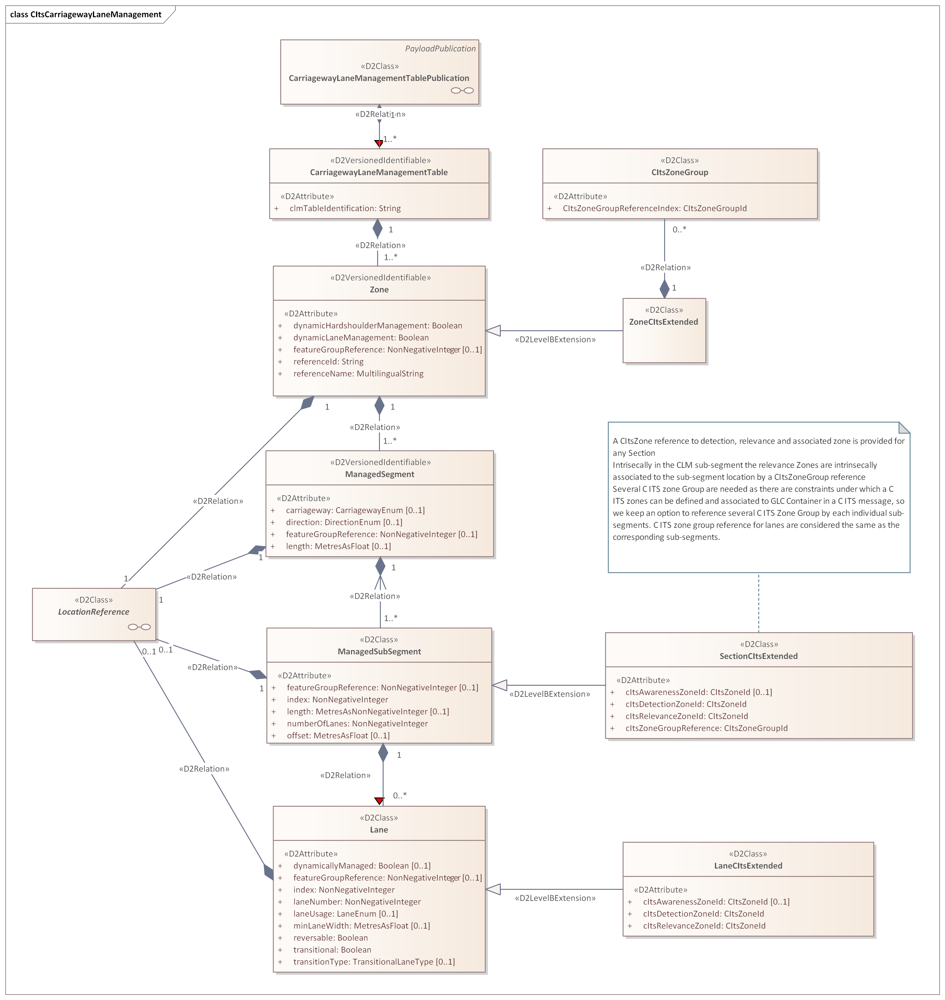
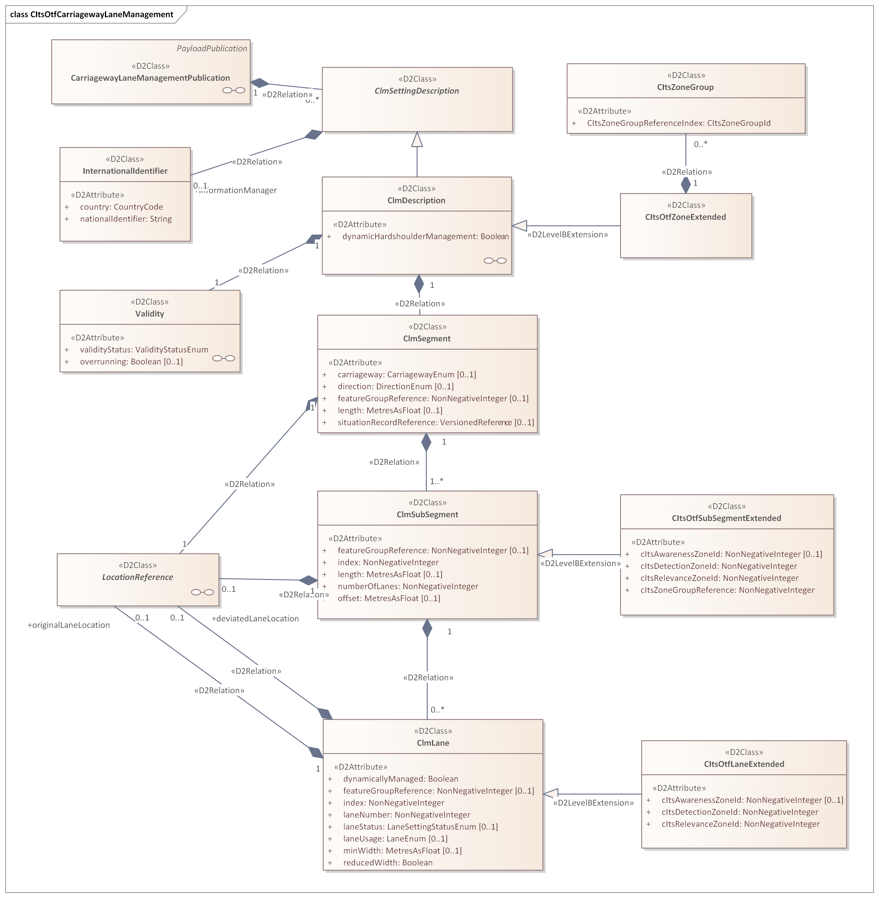
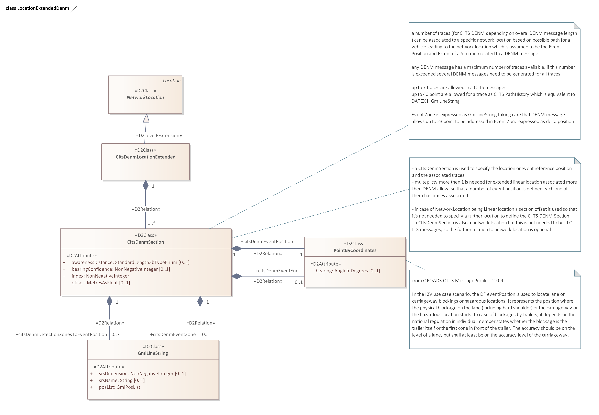
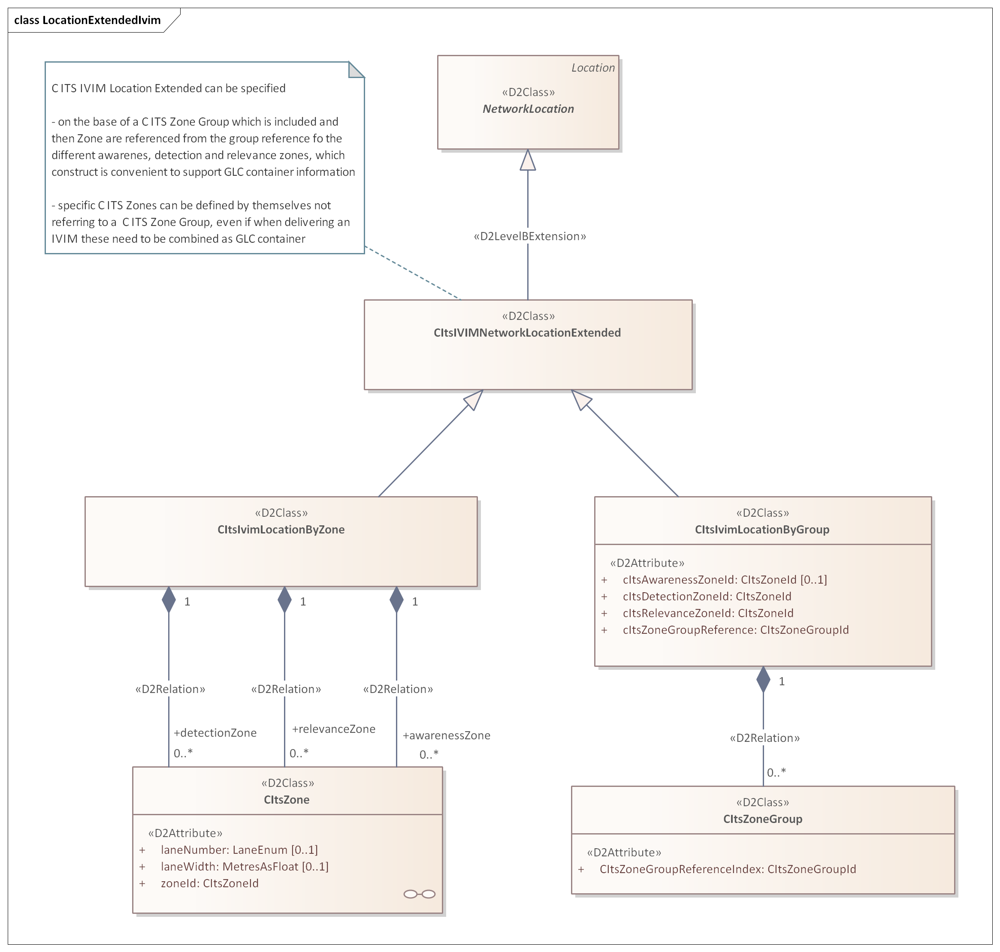

# C-ITS Extension

Carriageway Lane Managent extension with extension for C-ITS purpose.

Submitted by Fabrizio.Paoletti

## Model

Based on [DATEX II v3.4](https://docs.datex2.eu/downloads/modelv34/).
- [CarriagewayLaneManagementV3.4.xml](model/CarriagewayLaneManagementV3.4.xml) contains the `D2Namespace CarriagewayLaneManagement` for importing in PayloadPublication.
- [CItsExtensionV3.4.xml](model/CItsExtensionV3.4.xml) contains the `D2Namespace CItsExtension`  for importing in Extension.

## Documentation

