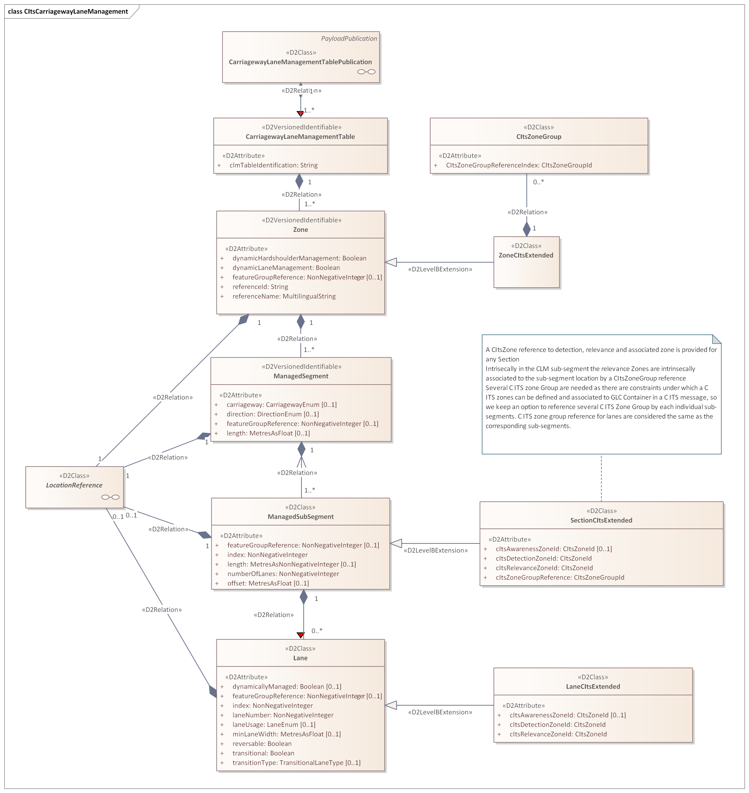
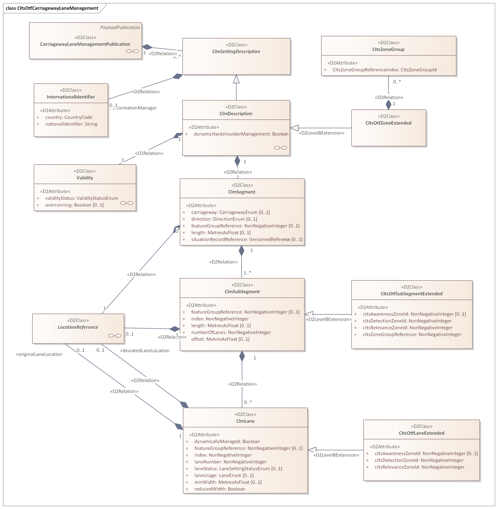
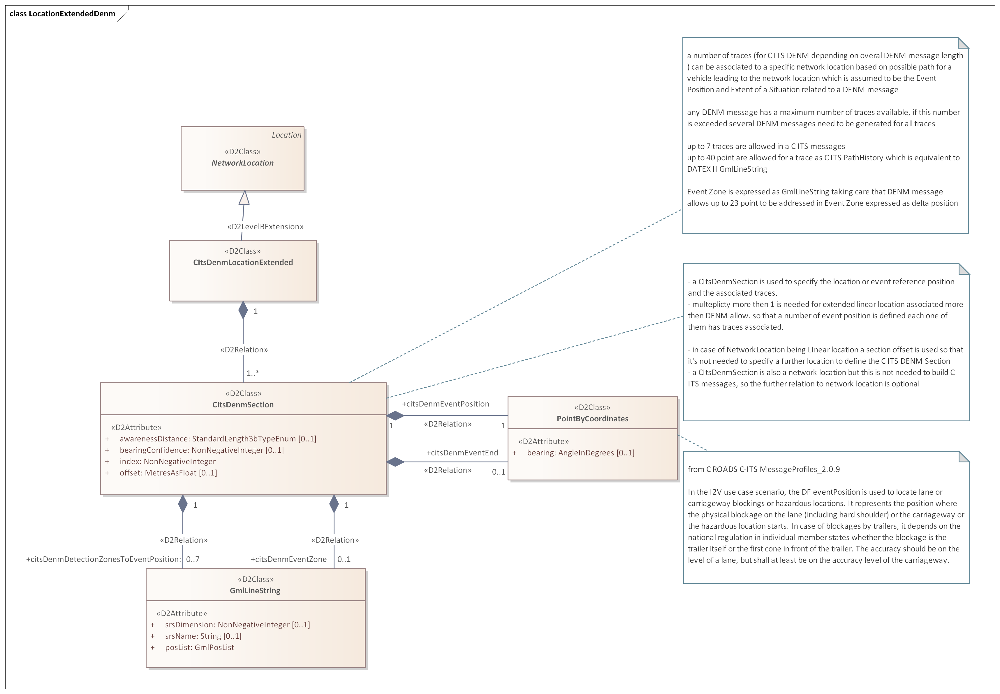
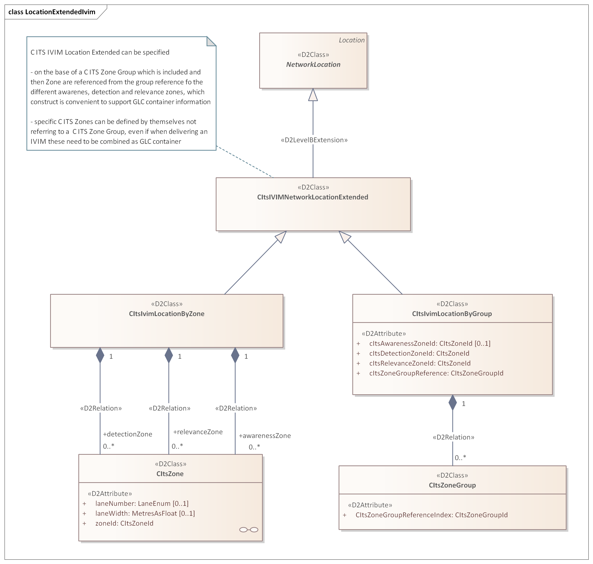

# C-ITS Extension

Carriageway Lane Managent extension with extension for C-ITS purpose.

Submitted by Fabrizio.Paoletti

## The package includes

- an updated Carriageway & Lane Management Payload Publication after the official release done for version 3 in the previous NAPCORE phase.

- a C-ITS extension which extends the Location for Situation and VMS Publication to provide IVIM and DENM data required by those C-ITS messages, and it also extend some classes of the proposed CLM model to provide the same data for IVIM Management.

## Model

Based on [DATEX II v3.4](https://docs.datex2.eu/downloads/modelv34/).
- [CarriagewayLaneManagementV3.4.xml](model/CarriagewayLaneManagementV3.4.xml) contains the `D2Namespace CarriagewayLaneManagement` for importing in PayloadPublication.
- [CItsExtensionV3.4.xml](model/CItsExtensionV3.4.xml) contains the `D2Namespace CItsExtension`  for importing in Extension.

## Documentation

